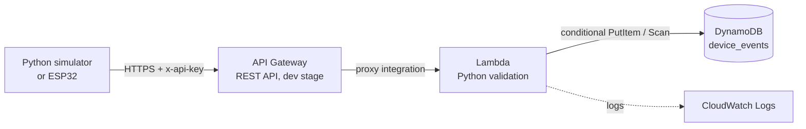

# Serverless Device Event Logger

A serverless ingestion pipeline on AWS. A Python script simulates an IoT device (button press, finished timer session) and sends events over HTTPS. AWS validates each event, rejects duplicates, and stores it. The simulator can later be replaced by a real Arduino or ESP32 without changing the cloud side.

## Architecture



| Component | Role |
|---|---|
| API Gateway | Public HTTPS endpoint, API key check, throttling and quota via usage plan |
| Lambda (Python) | Parses and validates requests, writes to DynamoDB, returns correct status codes |
| DynamoDB | Stores events, partition key `event_id` |
| IAM | Least-privilege execution role: `PutItem` and `Scan` on one table only |

## API

Base: `https://<api-id>.execute-api.<region>.amazonaws.com/dev`. All requests need an `x-api-key` header.

### `POST /events`

```json
{"device_id": "timer-01", "event_id": "abc123", "type": "session_complete"}
```

| Status | Meaning |
|---|---|
| 201 | Event stored |
| 400 | Invalid JSON, or a required field is missing, blank, or not a string |
| 409 | Duplicate `event_id`, event was not stored again |
| 403 | Missing or invalid API key (rejected by API Gateway, Lambda never runs) |

### `GET /events`

Returns up to 50 stored events, newest first.

## Design decisions

- **Conditional write for duplicate prevention.** `attribute_not_exists(event_id)` makes DynamoDB check and write in one atomic operation. A check-then-write approach has a race window where two simultaneous requests both pass the check.
- **Client-generated `event_id` (idempotency).** The device creates a UUID once per real event and reuses it on retries, so retrying after a network failure is always safe.
- **Server-side `received_at`.** Device clocks can't be trusted, so the backend stamps arrival time.
- **Validation before storage.** Bad input returns a specific 4xx and never reaches the database. Correct codes tell clients whether to retry (5xx) or not (4xx).
- **Least-privilege IAM.** The Lambda role can only `PutItem` and `Scan` on one table (see `iam/lambda-dynamodb-policy.json`).
- **Config via environment variables.** The table name is a Lambda environment variable, and the simulator reads its URL and API key from the environment, so no secrets are committed.
- **API key plus usage plan.** Limits abuse and cost (5 req/s, burst 10, 1,000 requests/day). This is throttling and identification, not real authentication.
- **Scan today, Query at scale.** `GET /events` uses `Scan`, which is fine for a small table. At scale I'd add a GSI on `device_id` with a timestamp sort key and use `Query`.

## Repo layout

```
.
├── lambda/lambda_function.py     # Lambda handler (POST + GET)
├── simulator/
│   ├── simulator.py              # Simulated device
│   └── requirements.txt
├── iam/lambda-dynamodb-policy.json
├── docs/                         # Screenshots
├── .env.example
└── README.md
```

## Deploy it yourself

1. **DynamoDB:** create table `device_events`, partition key `event_id` (String), on-demand capacity.
2. **Lambda:** create a Python function, paste in `lambda/lambda_function.py`, set the environment variable `TABLE_NAME=device_events`, and Deploy. The handler is `lambda_function.lambda_handler`.
3. **IAM:** add `iam/lambda-dynamodb-policy.json` (with your region and account ID filled in) as an inline policy on the function's execution role.
4. **API Gateway:** create a REST API with an `/events` resource and POST and GET methods using Lambda proxy integration. Require an API key on both, create a usage plan, attach a key, then deploy to a `dev` stage.
5. Do not put the Lambda in a VPC. It isn't needed and can add NAT Gateway cost.

## Run the simulator

```powershell
cd simulator
pip install -r requirements.txt
$env:API_URL = "https://<api-id>.execute-api.<region>.amazonaws.com/dev/events"
$env:API_KEY = "<your-key>"
python simulator.py
```

Expected output:

```
201 {'status': 'stored', 'event_id': '...'}
409 {'error': 'duplicate event_id'}
201 {'status': 'stored', 'event_id': '...'}
```

## What I tested

- Successful event storage (201)
- Duplicate event rejection through the public endpoint (409)
- Requests without an API key rejected (403)
- Event history retrieval via `GET /events`

## What I'd do next

- Test failure paths systematically (malformed JSON, wrong types, removed IAM permission) and document the CloudWatch logs
- CloudWatch alarms on Lambda errors and a dead-letter queue
- Stronger auth (Cognito or a Lambda authorizer) instead of API keys
- A GSI for per-device queries
- Replace the simulator with real ESP32 or Arduino hardware
- Infrastructure as code (AWS SAM or Terraform)
